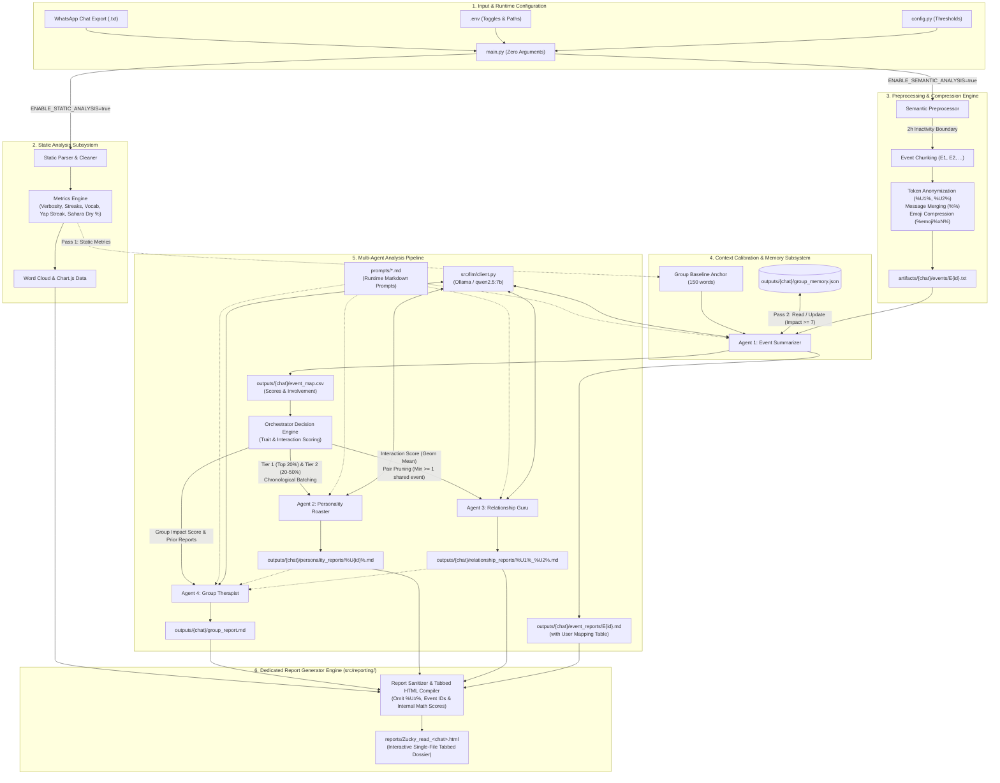

# Release Requirements: Zucky's Reading v2.0

**Target Version:** `v2.0`  
**Scope:** Multi-Agent Semantic Analysis Pipeline, Codebase Modular Decoupling, Dedicated Tabbed Report Generator Engine, and Model Isolation  
**Target Hardware:** NVIDIA GeForce RTX 5050 (8GB VRAM) on Ubuntu Linux  
**Status:** DRAFT (Awaiting User Review & Verification)  
**Git Policy:** This document will be committed to `develop` only after `main`, `develop`, and `release-1.0` base branches are created and verified.

---

## 1. End-to-End Application Workflow Diagram & Pipeline Details



### Detailed Pipeline Stages

#### Stage 1: Zero-Argument Entrypoint & Configuration
* **Invocation:** `python main.py` runs with zero arguments.
* **`.env`:** Reads `CHAT_EXPORT_PATH`, toggles (`ENABLE_STATIC_ANALYSIS`, `ENABLE_SEMANTIC_ANALYSIS`), model name, and API endpoints.
* **`config.py`:** Provides algorithmic thresholds (`INACTIVITY_GAP_HOURS = 2.0`, batch caps, gating percentiles).

#### Stage 2: Static Analysis Subsystem (Segregated under `src/static/`)
* **Parsing:** Normalizes timestamps, cleans invisible formatting tokens (`\u200e`, `\u202f`), strips system messages.
* **Calculations:** Computes member verbosity, pure text response speed, Yap Streak (media excluded), Sahara Desert dry rate, group & individual vocabularies, and active/inactive streaks with exact dates.
* **Data Output:** Produces structured static metrics and Word Cloud vector graphics for the Report Generator.

#### Stage 3: Semantic Preprocessing Subsystem (Segregated under `src/semantic/`)
* **Segmentation:** Groups contiguous messages delimited by a silence gap $\ge 2.0$ hours into numbered events $E_1, E_2, \dots$.
* **Compression:**
  - Names and `@` mentions converted to `%U1%`, `%U2%` user codes based on alphabetical full name order.
  - Consecutive messages by the same user merged with `%%` delimiters.
  - Repeated emoji runs $\ge 3$ compressed to `%{emoji}x{count}%`.
  - Timestamps removed from message lines; start date/time and duration placed in event header.
* **Storage:** Persisted to `artifacts/{chat_name}/events/E{id}.txt`.

#### Stage 4: Context Calibration & Memory Subsystem (Two-Pass Dynamic Decay Engine)
* **Pass 1 (Zero-Bias Statistical Anchor):** Before running Agent 1, Python deterministically synthesizes a strictly objective mathematical calibration anchor from static metrics (participant count, conversation volume percentiles: 25th, median, 75th, 90th, average message length, daytime vs night distribution, response speed). It contains zero editorializing or genre assumptions, leaving tone and relationship discovery solely to the LLM.
* **Pass 2 (Adaptive Rolling Memory & Size-Class Decay Schedule):** Maintains `outputs/{chat_name}/group_memory.json` (inside jokes, ongoing feuds, active eras). Instead of a static threshold, the trigger threshold dynamically decays based on chat size classes:
  - **Chat Size Classes:**
    - `XS`: $< 1,000$ messages
    - `S`: $< 5,000$ messages
    - `M`: $< 10,000$ messages
    - `L`: $< 20,000$ messages
    - `XL`: $\ge 20,000$ messages
  - **Coefficients:**
    - Message ratio $k = 0.05$
    - Bootstrap multiplier $\alpha$: XS=16 (80%), S=10 (50%), M=4 (20%), L=2 (10%), XL=1 (5%)
    - Calibration multiplier $\beta$: XS=4 (20%), S=5, M=6, L=5, XL=4
  - **Formulas:**
    - Bootstrap threshold ($T=1$): $\text{alpha\_messages} = \alpha \times k \times \text{total\_messages}$
    - Calibration threshold ($T=5$): $\text{beta\_messages} = (\text{total\_messages} - \text{alpha\_messages}) \times k \times \beta$
    - Canon stability threshold ($T=7$): Remaining messages after bootstrap and calibration.
  - Subsequent agents read `group_memory.json` (~150 tokens) to recognize callbacks without parallel GPU execution.

#### Stage 5: Multi-Agent Analysis Pipeline
* **Prompt Loading:** System prompts dynamically loaded at runtime from `prompts/*.md`.
* **LLM Layer:** Single model instance (`qwen2.5:7b-instruct`) queried sequentially via `src/llm/client.py` using strict JSON schema output.
* **Agent 1 (Event Summarizer):** Evaluates compressed event chunks, assigns `impact_strength` (1–10) and individual `involvement_scores` (1–10). Outputs `event_reports/E{id}.md` (containing User Mapping Table) and appends to `event_map.csv`.
* **Orchestrator Decision Engine:** Calculates mathematical gating:
  - `trait_marking_score = involvement * impact`
  - `interaction_score = sqrt(score_U1 * score_U2)`
  - `group_impact_score = Mean(involvement) * impact`
* **Agent 2 (Personality Roaster):** Tier 1 (top 20%) receives raw event + report; Tier 2 (20–50% or score > 50) receives batched reports (up to 10 reports / 4k tokens). Events sorted chronologically. Outputs `personality_reports/%U{id}%.md`.
* **Agent 3 (Relationship Guru):** Evaluates member pairs. Prunes pairs with 0 co-occurring events. Chronologically sorted. Outputs `relationship_reports/%U1%_%U2%.md`.
* **Agent 4 (Group Therapist):** Synthesizes top 20% group impact events + Personality + Relationship outputs into `group_report.md`.

#### Stage 6: Dedicated Report Generator Engine (Segregated under `src/reporting/`)
* Reads outputs from Static and Semantic subsystems.
* **Sanitization:** Strips `%U#%` tokens, replaces raw `E#` IDs with real event titles, and omits internal mathematical formulas.
* **Compilation:** Assembles the final, user-friendly, interactive tabbed HTML dossier into `reports/Zucky_read_<chat>.html`.

---

## 2. Architectural & Structural Requirements

### [REQ-ARC-01] Module Segregation
- The codebase must be strictly decoupled into isolated modules under `src/`:
  - `src/common/`: Shared parser and data models (agnostic of analysis type).
  - `src/static/`: Static analysis engine. Must not import from or depend on semantic or reporting modules.
  - `src/semantic/`: Preprocessing, agents, rolling memory, and orchestrator. Must not import from or depend on static or reporting modules.
  - `src/llm/`: Isolated model provider interface.
  - `src/reporting/`: Dedicated Report Generator Engine. Reads static metrics and semantic reports, sanitizes tokens, and compiles the final tabbed HTML dossier.
- Modifications to any one module must never cause breaking changes or side-effects in other modules.

### [REQ-ARC-02] Externalized Markdown Agent Prompts
- Agent system prompts must reside in editable `.md` files under `prompts/`:
  - `prompts/event_summarizer.md`
  - `prompts/group_memory_updater.md`
  - `prompts/personality_roaster.md`
  - `prompts/relationship_guru.md`
  - `prompts/group_therapist.md`
- Prompts must be loaded dynamically at runtime with string template substitution (`{placeholders}`). Modifying prompt text, banter style, or guidelines must require zero Python code edits.

### [REQ-ARC-03] Swappable LLM Provider Layer
- All local LLM calls must pass through `src/llm/client.py`.
- The interface must decouple the orchestrator from the underlying provider (Ollama, vLLM, llama.cpp, or remote API).
- Default implementation must connect to local **Ollama** (`http://localhost:11434`) using `qwen2.5:7b-instruct-q4_K_M` with strict JSON schema enforcement.

### [REQ-ARC-04] Configuration & Execution Contract
- Running the pipeline must require a single zero-argument command:
  ```bash
  python main.py
  ```
- **`.env`** must supply all runtime parameters:
  - `CHAT_EXPORT_PATH`: Path to the raw WhatsApp `.txt` file.
  - `ENABLE_STATIC_ANALYSIS`: Boolean toggle (`true`/`false`).
  - `ENABLE_SEMANTIC_ANALYSIS`: Boolean toggle (`true`/`false`).
  - `MODEL_NAME`: Name of the model (default: `qwen2.5:7b`).
  - `OLLAMA_BASE_URL`: API endpoint (default: `http://localhost:11434`).
- **`config.py`** must centralize all mathematical thresholds and limits (e.g. 2h inactivity gap, percentiles, token limits).

---

## 3. Dedicated Report Generator Engine Requirements (`src/reporting/`)

### [REQ-REP-01] Subsystem Isolation & Inputs
- The Report Generator Engine must exist as an independent module under `src/reporting/`.
- It takes two input sources:
  1. `StaticAnalysisReport` object or static metrics cache.
  2. The semantic output files in `outputs/{chat_name}/` (`group_report.md`, `personality_reports/*.md`, `relationship_reports/*.md`, `event_reports/*.md`, `group_memory.json`).
- Output destination must strictly be: `reports/Zucky_read_<chat_name>.html`.

### [REQ-REP-02] Strict Token & Internal Metric Sanitization
- **Omit User Codes:** All occurrences of `%U1%`, `%U2%`, etc., must be deterministically replaced with the member's friendly display name.
- **Omit Raw Event IDs:** All occurrences of `E14`, `E42`, etc., in callbacks or timelines must be replaced with the human-readable event title (e.g., *"The Great RCB Banter on 12 Apr 2026"*).
- **Omit Internal Scoring Formulas:** Intermediate math parameters (`trait_marking_score`, geometric mean formulas, raw percentile thresholds) must be excluded from the final report. Only intuitive, user-friendly indicators (e.g., Relationship Strength 1–10, Involvement Level, Impact Rating) may be displayed.

### [REQ-REP-03] Interactive Tabbed User Interface
The generated HTML report must feature a polished dark-mode navigation bar with the following 5 distinct tabs:
1. **🛋️ Tab 1: Group Therapy & Identity**
   - Group Title, Apt Emoji, and Era
   - Group Evolution Timeline
   - Master Unfiltered Group Roast (Agent 4)
2. **📊 Tab 2: Static Stats & Charts**
   - KPI metrics ribbon (Volume, Words, Media, Active Streaks with exact dates, Vocabularies)
   - Hall of Shame & Superlative Cards
   - 4 Chart.js interactive charts (Message Share pie with white borders, 24h hourly activity with peak highlight, weekday activity, monthly progression with peak beacon)
   - Top 20 Most Used Words (Word Cloud vector image + interactive chips)
3. **👤 Tab 3: Member Dossiers**
   - Side-by-side member cards (strictly 2 per row on desktop)
   - Real member display names
   - Combined statistical badges (verbosity, pure text response speed, yap streak, dry text %, vocab size)
   - Personality descriptor title & emoji
   - Personalized character roasts with human-readable callbacks
   - Strengths and Weaknesses
4. **🤝 Tab 4: Relationship Matrix**
   - Interactive pair cards or filterable grid
   - Couple titles & couple apt emojis
   - Relationship evolution timeline
   - Dynamic characteristics & traits
   - Overall Relationship Strength Score (1–10)
   - Clean summary for pruned pairs (*"Zero recorded interaction"*)
5. **📜 Tab 5: Canon Events Archive**
   - Chronological timeline of high-impact events
   - Human-readable event names and dates
   - Detailed breakdown (what happened, who said what, hot takes, banter, notable quotes)
   - Involved participants and their roles

---

## 4. Semantic Analysis Functional Requirements

### [REQ-SEM-01] Deterministic Event Preprocessing & Compression
- **Boundary:** Events delimited by an inactivity gap $\ge 2.0$ hours.
- **User Anonymization:** Replace member names and `@` mentions with alphabetical `%U1%`, `%U2%` user codes based on full contact names.
- **Header Injection:** Strip message timestamps from message lines; inject event ID, start timestamp, duration, and user legend in the header.
- **Message Merging:** Merge uninterrupted consecutive messages from the same user using `%%` delimiters.
- **Emoji Normalization:** Runs of $\ge 3$ consecutive emojis compressed to `%{emoji}x{count}%`.
- **Noise Stripping:** Completely remove `<Media omitted>`, `This message was deleted`, and system notices (`added`, `left`, `changed group name/icon`).
- **Persistence:** Save compressed event texts to `artifacts/{chat_name}/events/E{id}.txt`.

### [REQ-SEM-02] Two-Pass Dynamic Baseline & Adaptive Memory Decay Schedule
- **Pass 1 (Zero-Bias Statistical Anchor):** Generate a purely objective, mathematical calibration anchor from static metrics:
  - Participant counts (total and active)
  - Conversation volume percentiles ($25^{\text{th}}$, median, $75^{\text{th}}$, $90^{\text{th}}$)
  - Typical message length and response speeds
  - Day vs night activity breakdown
  - Explicit instruction to make zero assumptions about group genre, tone, or intimacy level.
- **Pass 2 (Adaptive Rolling Memory Decay):** Maintain `outputs/{chat_name}/group_memory.json` tracking active eras, inside jokes, and alliances/feuds.
- **Dynamic Size-Class Memory Schedule:**
  - Chat size categorized into `XS` (<1k), `S` (<5k), `M` (<10k), `L` (<20k), and `XL` (20k+).
  - Configurable parameters: `MESSAGE_RATIO_K = 0.05`, $\alpha$ multipliers, $\beta$ multipliers.
  - Phase 1 (Bootstrap, Threshold = 1): Runs on all events until cumulative messages reach $\text{alpha\_messages} = \alpha \times k \times \text{total\_messages}$.
  - Phase 2 (Calibration, Threshold = 5): Runs on events until cumulative messages reach $\text{alpha\_messages} + \text{beta\_messages}$, where $\text{beta\_messages} = (\text{total\_messages} - \text{alpha\_messages}) \times k \times \beta$.
  - Phase 3 (Canon Stability, Threshold = 7): Events after calibration update only if `impact_strength >= 7`.
- **Validation Contract:** `scripts/check_config` validates that $(\alpha + \beta) \times k \le 1.0$ across all size classes, ensuring bootstrap and calibration do not exceed 100% of messages.

### [REQ-SEM-03] Agent 1: Event Summarizer
- Evaluates compressed events one by one (stateless).
- Outputs strict JSON validating:
  - `event_id`: e.g. `E14`
  - `event_name`: Format `{event_name} {apt preposition/joining word} {date}` (e.g. `The Great RCB Banter on 12 Apr 2026`)
  - `impact_strength`: Integer `1` to `10`
  - `involvement_scores`: Dict of `%U#%` to score `1` to `10`
  - `topics`, `what_happened`, `who_said_what`, `hot_takes`, `singling_out`, `banter_analysis`, `emotional_disturbances`, and `notable_quotes`.
- Saves structured report to `outputs/{chat_name}/event_reports/E{id}.md` containing the **User Mapping Table** (%U#% $\rightarrow$ Name $\rightarrow$ Involvement).
- Appends summary record to `outputs/{chat_name}/event_map.csv`.

### [REQ-SEM-04] Agent 2: Personality Roaster
- Runs per member in alphabetical order of user codes.
- Computes `trait_marking_score = individual_involvement_score * impact_strength`.
- **Tier 1 (Top 20%):** Fed raw compressed event + event report.
- **Tier 2 (20–50% or score > 50):** Fed batched event reports (capped at 10 reports / 4,000 tokens per call).
- Events must be **sorted chronologically** before feeding to the agent.
- Progressively outputs `outputs/{chat_name}/personality_reports/%U{id}%.md`:
  - Name, Title (Personality Descriptor), Apt Emoji
  - Unfiltered roast with direct callbacks to high-impact event IDs
  - Strengths and Weaknesses
  - Top 5 Event IDs

### [REQ-SEM-05] Agent 3: Relationship Guru
- Runs per unique pair of members.
- Computes `interaction_score = sqrt(score_U1 * score_U2)`.
- **Pair Pruning:** Pairs with 0 co-occurring conversations bypass LLM and receive an automatic static evaluation: *"Zero recorded direct interaction"*.
- **Tier 1 (Top 20%):** Raw event + event report.
- **Tier 2 (20–50% or score > 50):** Batched reports chronologically.
- Progressively outputs `outputs/{chat_name}/relationship_reports/%U1%_%U2%.md`:
  - Couple title & Apt emoji
  - Relationship evolution timeline
  - Relationship dynamics & traits
  - Strength Score (1–10)

### [REQ-SEM-06] Agent 4: Group Therapist
- Runs once after all prior agents complete.
- Computes `group_impact_score = Mean(involvement_scores) * impact_strength`.
- Consumes top 20% events with raw text + 20-50% batched reports + personality reports + relationship reports.
- Outputs `outputs/{chat_name}/group_report.md`:
  - Group Identity & Group Apt Emoji
  - Group Evolution Timeline
  - Comprehensive Group Roast with callbacks to top event IDs
  - Top 10 Event IDs

---

## 5. Non-Functional & Safety Requirements

### [REQ-NFR-01] VRAM Budget & Concurrency Safety
- Peak VRAM must not exceed **6.5 GB** on the RTX 5050 (8GB capacity).
- Parallel LLM worker processes are strictly forbidden. All model invocations must be sequential.
- Context window per invocation capped at 8,192 tokens; batch payloads capped at 4,000 tokens.

### [REQ-NFR-02] Strict Version Control & Merge Governance
- Branching structure:
  - `main`: Production LTS (Release 1.0 $\rightarrow$ Release 2.0).
  - `release-<version>`: Milestone archive with non-verbose `release_notes.md`.
  - `develop`: Integration ground for feature branches.
  - `f-<feature_name>`: Individual feature work.
- **STRICT MERGE GATE:** The assistant will **never merge any branch autonomously**. All merges require personal verification and explicit instruction by the user.
- Auto-delete on merge is disabled for non-feature branches (`main`, `develop`, `release-*`).

### [REQ-NFR-03] Data Privacy & Security
- `.gitignore` must immediately and permanently exclude `chats/*.txt`, `.env`, `.venv/`, `artifacts/`, `outputs/`, and `reports/`.
- No user message content or personal identifiers may be committed to Git history.

### [REQ-NFR-04] Documentation
- Every branch must maintain an updated, concise `README.md` explaining what the application does and the exact command to run it.
- Every release branch must contain a non-verbose `release_notes.md` outlining only features supported by that release.

---

## 6. Definition of Done (DoD) Checklist for Release v2.0

- [ ] All code refactored into `src/common/`, `src/static/`, `src/semantic/`, `src/llm/`, and `src/reporting/`.
- [ ] Dedicated Report Generator Engine implemented in `src/reporting/`.
- [ ] All usercodes (%U#%) sanitized to friendly display names in final report.
- [ ] All raw event IDs (E#) converted to human-readable event titles in final report.
- [ ] Internal mathematical formulas and scoring parameters omitted from final report.
- [ ] Final HTML report generated at `reports/Zucky_read_<chat_name>.html` with an interactive 5-tab navigation bar.
- [ ] `prompts/*.md` templates loaded dynamically at runtime.
- [ ] `.env` and `config.py` enable zero-argument execution (`python main.py`).
- [ ] `preprocessor.py` successfully compresses events to `artifacts/{chat}/events/E{id}.txt`.
- [ ] Agent 1 generates `event_reports/E{id}.md` with usermap tables and populates `event_map.csv`.
- [ ] Rolling `group_memory.json` updates on high-impact events ($\ge 7$).
- [ ] Agent 2 generates `personality_reports/%U{id}%.md` with top 5 event callbacks.
- [ ] Agent 3 generates `relationship_reports/%U1%_%U2%.md` with pair pruning.
- [ ] Agent 4 generates `group_report.md` with top 10 event callbacks.
- [ ] System runs end-to-end within RTX 5050 8GB VRAM with zero OOM errors.
- [ ] User has tested all feature branches on `develop` and explicitly authorized the `release-2.0` cut and merge into `main`.
